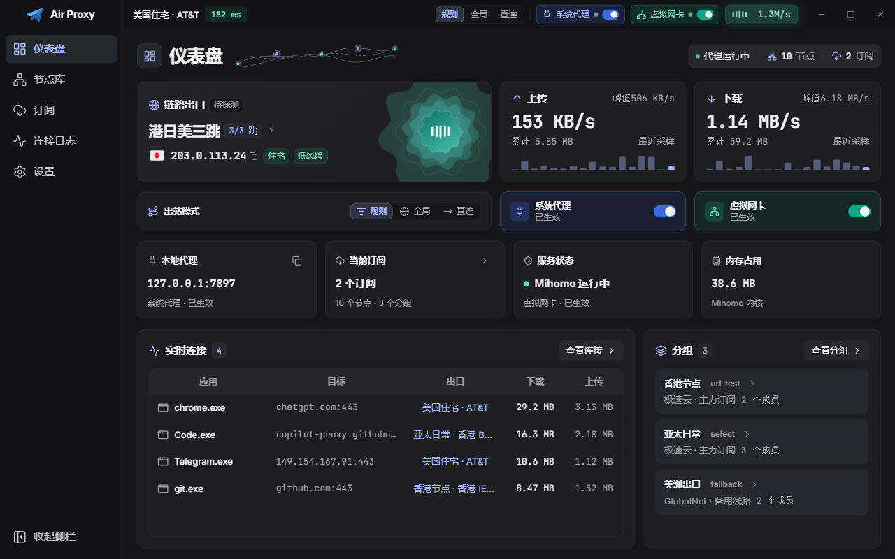
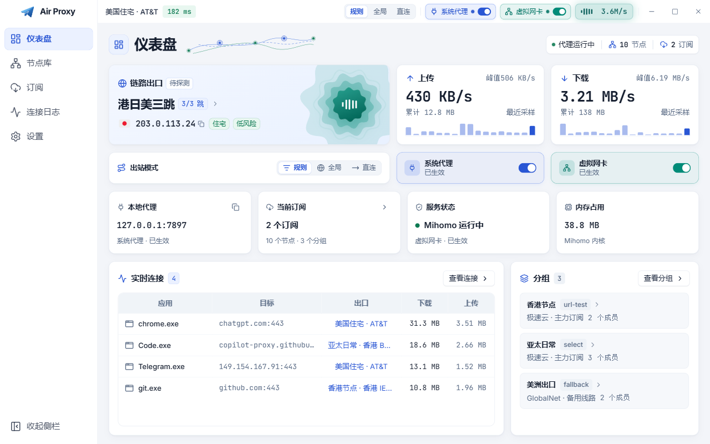
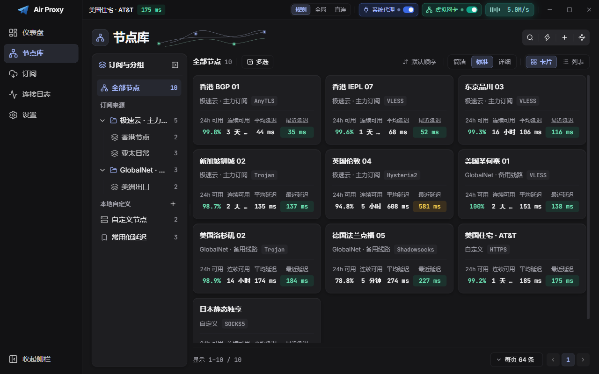
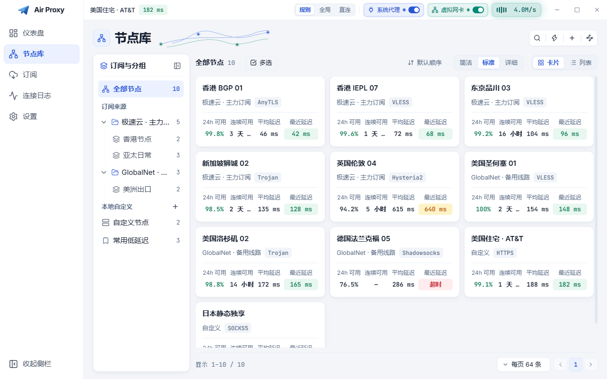
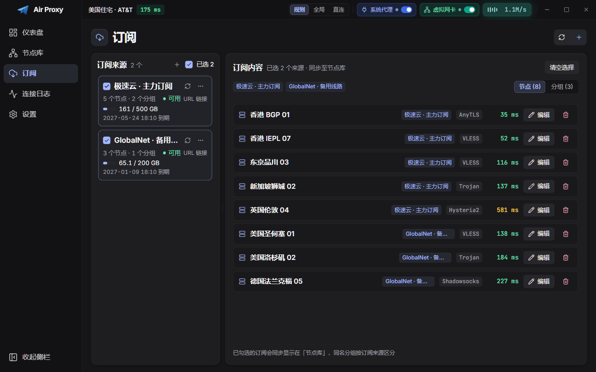
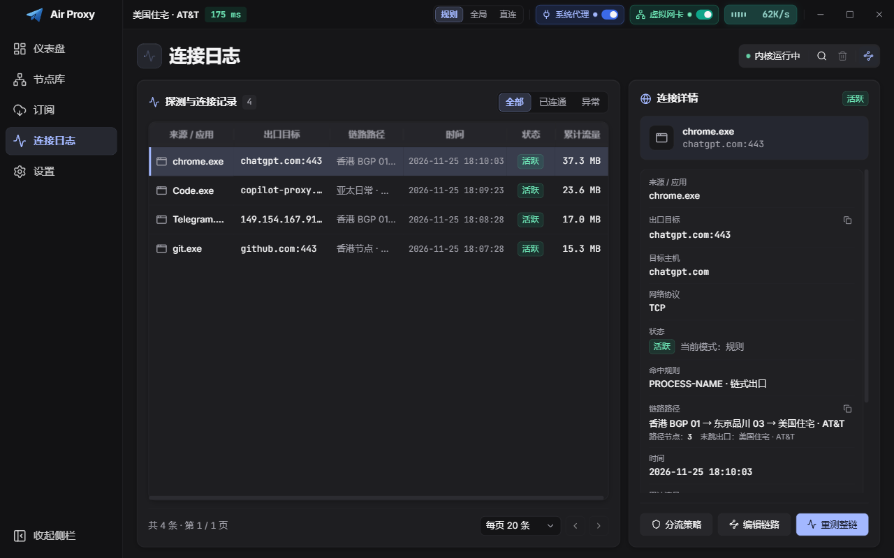
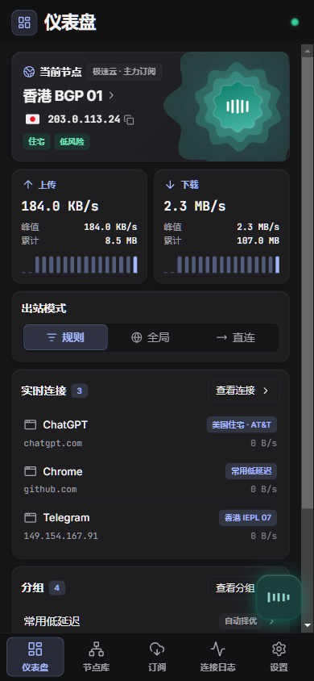
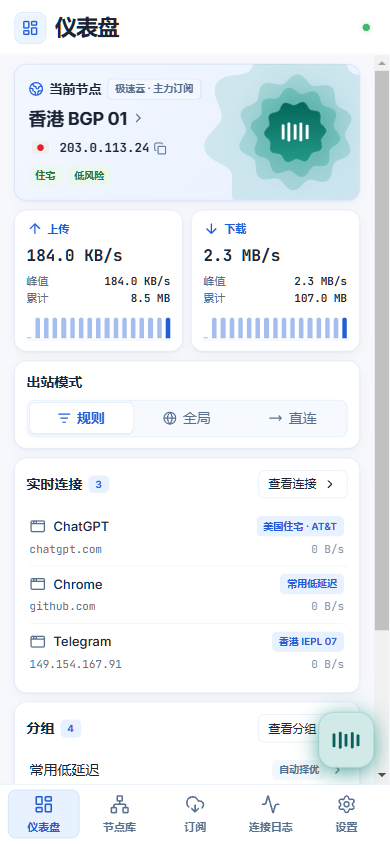
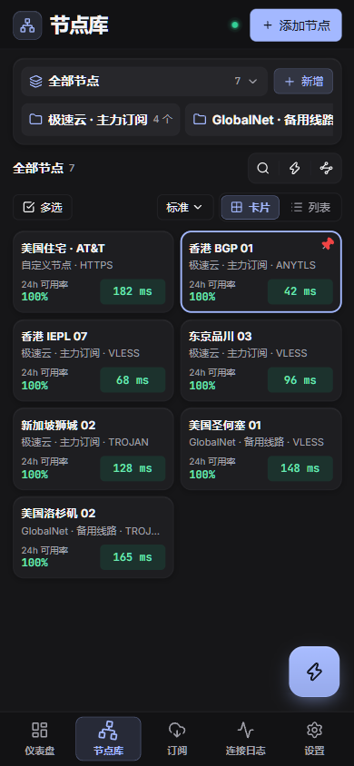
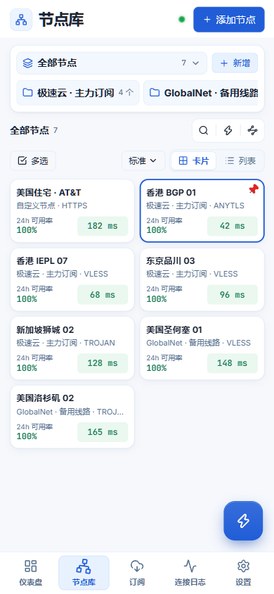

<div align="center">


# Air Proxy

Cross-platform proxy client powered by the Mihomo core, supporting Windows desktop and Android.

[简体中文](./README.md) · **English**

[](https://github.com/GuoWWWX/Air-Proxy/releases/latest)
[](https://github.com/GuoWWWX/Air-Proxy/releases/latest)
[](https://github.com/MetaCubeX/mihomo)
[](./LICENSE)

[Latest Release](https://github.com/GuoWWWX/Air-Proxy/releases/latest) · [Feature Guide](./docs/页面功能说明.md) · [Docs Hub](./docs/README.md) · [Build & Dev](./docs/开发构建与清理.md)

</div>

---

## Key Features

- **Subscriptions & YAML / JS Extensions**: Import via URL, local Clash YAML file, or QR code; filter across multiple subscriptions, preserve per-node/per-group local overrides, inspect effective configs with syntax highlighting, and transform profiles with sandboxed QuickJS scripts.
- **Node Library & Multi-Hop Chains**: Switch between card and list views across three density levels; run single-node or concurrent batch latency probes, inspect 24h availability and latency metrics, create custom strategy groups (`select` / `url-test` / `fallback`), and build visual multi-hop proxy chains (`dialer-proxy`) with end-to-end exit verification.
- **Routing & Live Diagnostics**: Full Clash / Mihomo rule syntax and `rule-providers` support with subscription rule inheritance plus per-app / per-domain overrides; view live throughput bars, exit IP & reputation badges, active connections, and historical connection logs.
- **Native Traffic Capture**:
  - **Windows (Tauri 2 + Rust + WebView2)**: Independent System Proxy and TUN Service (`AirTunService` + Wintun) toggles, DPAPI + SQLite encrypted storage, system tray controls, and launch-on-boot support.
  - **Android (Kotlin + WebView + `VpnService`)**: Bundled `libmihomo` native library, isolated `:monitor` background probing service, per-app routing, and full IPv4 / IPv6 / NAT64 tunnel capture.
- **In-App Update Delivery**: Windows supports Ed25519-signed block-level incremental updates with resume-on-interrupt under **Settings → About**; Android checks GitHub Releases periodically, matches the device ABI automatically, displays release notes, and provides direct APK downloads. Both platforms automatically fall back to the active local proxy when direct connections to GitHub are blocked.

---

## Screenshots

### Windows Desktop (Dark / Light)

<table>
  <tr>
    <th width="50%">Dashboard · Dark</th>
    <th width="50%">Dashboard · Light</th>
  </tr>
  <tr>
    <td></td>
    <td></td>
  </tr>
  <tr>
    <th>Node Library · Dark</th>
    <th>Node Library · Light</th>
  </tr>
  <tr>
    <td></td>
    <td></td>
  </tr>
  <tr>
    <th>Subscriptions · Dark</th>
    <th>Connection Logs · Dark</th>
  </tr>
  <tr>
    <td></td>
    <td></td>
  </tr>
</table>

### Android (Dark / Light)

<div align="center">
<table>
  <tr>
    <th width="25%">Dashboard · Dark</th>
    <th width="25%">Dashboard · Light</th>
    <th width="25%">Nodes · Dark</th>
    <th width="25%">Nodes · Light</th>
  </tr>
  <tr>
    <td align="center"></td>
    <td align="center"></td>
    <td align="center"></td>
    <td align="center"></td>
  </tr>
</table>
</div>

---

## Download & Installation

Download official builds from **[GitHub Releases](https://github.com/GuoWWWX/Air-Proxy/releases/latest)** and verify checksums against `SHA256SUMS.txt`.

| Platform | Artifacts | Requirements & Notes |
| --- | --- | --- |
| **Windows x64** | `Air-Proxy-<version>-windows-x64-setup.exe` | Windows 10 / 11 x64 (`x86-64-v2` CPU required for bundled Mihomo). Confirm UAC elevation once when enabling TUN for the first time; later upgrades run incrementally inside **Settings → About**. |
| **Android** | `Air-Proxy-Android-<version>-arm64-v8a.apk`<br />`armeabi-v7a` / `x86_64` / `universal` | `arm64-v8a` fits most modern phones; use `universal` if unsure. **Settings → About** checks for new releases and surfaces the best matching ABI APK link. |

---

## Project Structure & Documentation

Full Chinese documentation lives under [`docs/`](./docs/README.md):

| Path | Purpose |
| --- | --- |
| `src/` | Desktop React views, feature modules, Tauri IPC wrapper, and cross-platform shared components (`src/shared/`) |
| `src-tauri/` | Windows Rust backend, Mihomo process manager, elevated TUN service (`tun-service/`), SQLite/DPAPI storage, and signed updater |
| `android/web/` | Android WebView React UI (reusing `@/shared` and `@/assets`) |
| `android/app/` | Android Kotlin shell (`VpnService`, JNI Mihomo bridge, background monitor service, APK build configuration) |
| `resources/languages/` | Built-in `zh-CN.json` and `en.json` translation packs validated across both platforms |
| `scripts/` | Kernel & geodata staging, signed update packager (`prepare-update.py`), translation checker, and regression tests |
| `docs/` | Architecture notes, feature specs, release guides, release notes, and showcase screenshots |
| `design/` | Editable UI prototype (`air-prototype.pen`) |

---

## Development & Testing

`pnpm` manages the shared workspace frontend dependencies (Node.js 20.19+ or 22.12+):

```powershell
# Install frontend dependencies
pnpm install --frozen-lockfile

# Launch desktop UI browser preview (with built-in synthetic demo data)
pnpm dev

# Build and run cross-platform verification checks
pnpm build
pnpm exec tsc --noEmit -p android/web/tsconfig.json
node scripts/check-languages.mjs
node scripts/test-android-routing.mjs
node scripts/test-desktop-telemetry.mjs
cargo test --manifest-path src-tauri/Cargo.toml --locked
./android/gradlew.bat -p android :app:testDebugUnitTest
```

---

## License & Third-Party Notices

- Source code in this repository is licensed under the **[MIT License](./LICENSE)**.
- The bundled [Mihomo](https://github.com/MetaCubeX/mihomo) core is licensed under **GPL-3.0** and distributed as an unmodified standalone binary / native library alongside its build info, license file, and upstream source references in `THIRD-PARTY-NOTICES.md` on each release page.
- Windows releases also bundle Wintun and Microsoft Edge WebView2 Loader under their respective licenses documented in `THIRD-PARTY-NOTICES.md`.
