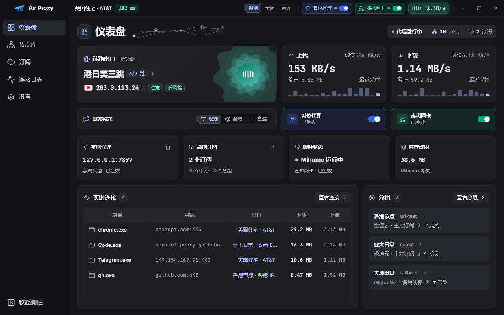
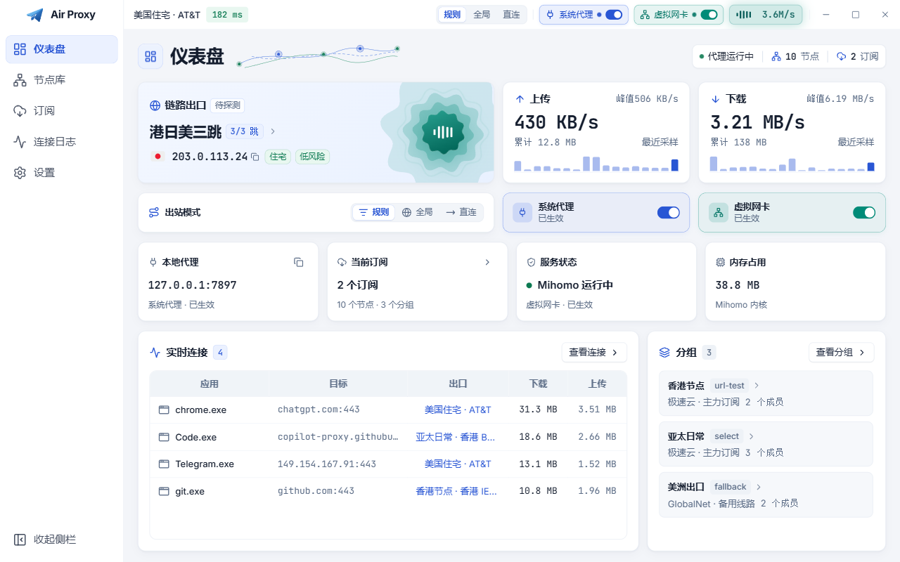
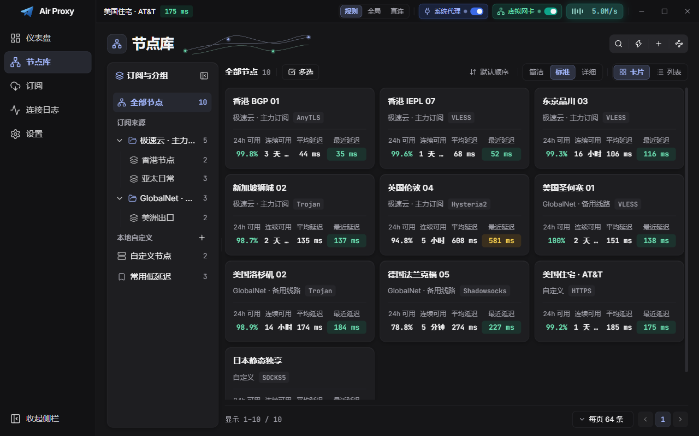
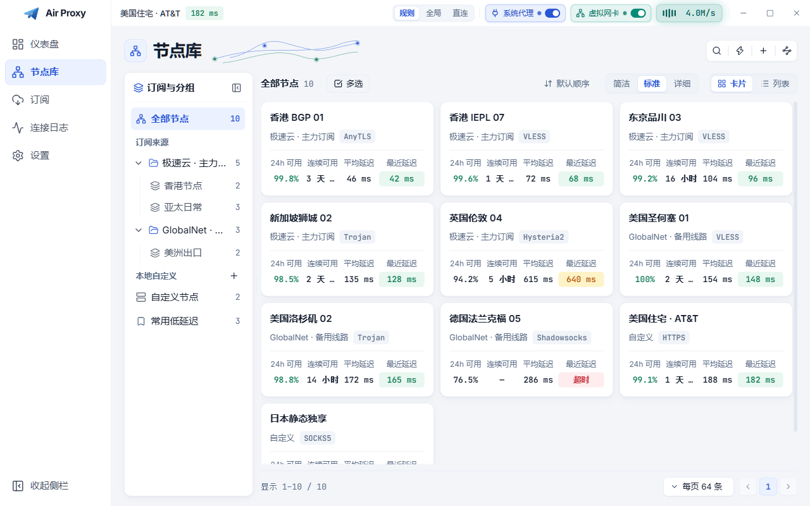
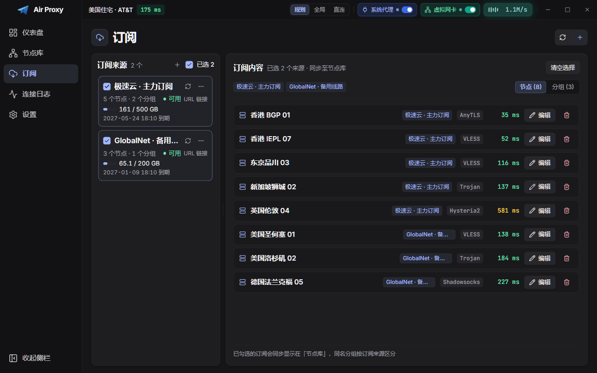
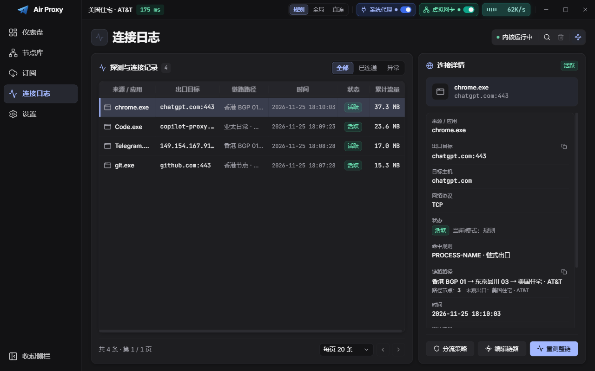
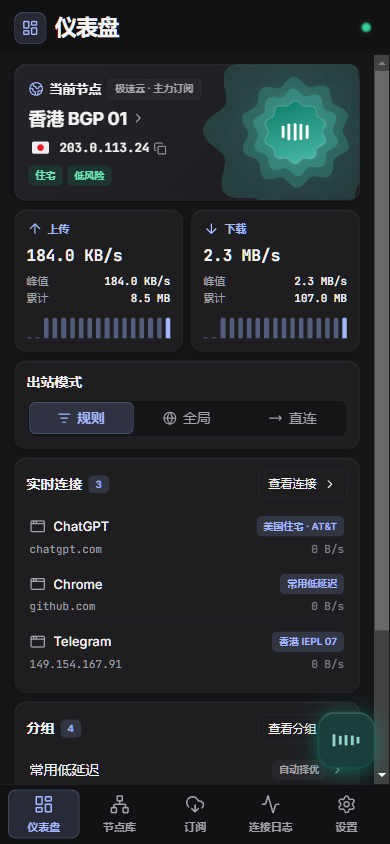
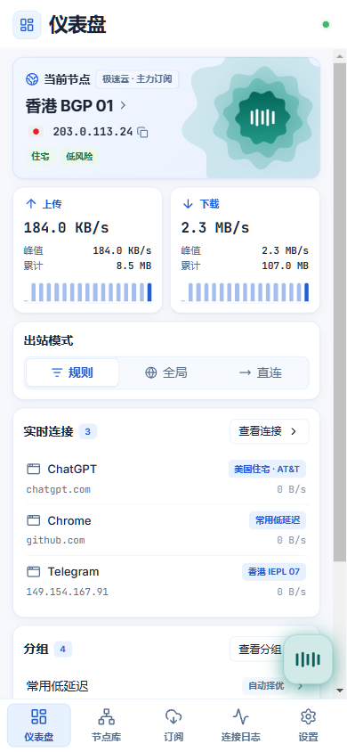
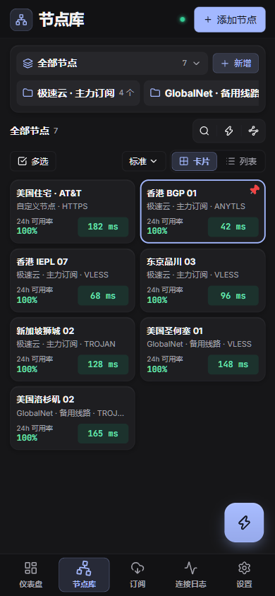
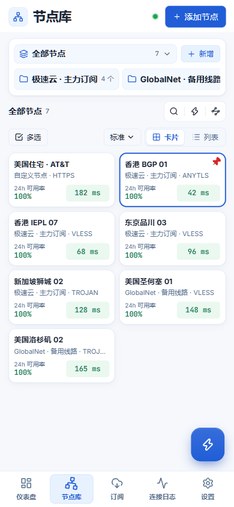

<div align="center">


# Air Proxy

基于 Mihomo 内核的跨平台代理客户端，支持 Windows 桌面端与 Android 移动端。

**简体中文** · [English](./README.en.md)

[](https://github.com/GuoWWWX/Air-Proxy/releases/latest)
[](https://github.com/GuoWWWX/Air-Proxy/releases/latest)
[](https://github.com/MetaCubeX/mihomo)
[](./LICENSE)

[下载最新版](https://github.com/GuoWWWX/Air-Proxy/releases/latest) · [功能说明](./docs/页面功能说明.md) · [文档中心](./docs/README.md) · [开发指南](./docs/开发构建与清理.md)

</div>

---

## 核心特性

- **订阅与 YAML / JS 扩展**：支持链接、本地 Clash YAML 文件与二维码导入；支持多订阅协同筛选、单节点与分组本地覆写、内置编辑器语法高亮及 QuickJS 沙箱扩展脚本。
- **节点库与多跳链路**：支持卡片 / 列表视图与三档信息密度，提供单节点及并发批量测速、24 小时可用率与延迟统计、自建策略组（`select` / `url-test` / `fallback`），以及可视化的多跳链式代理（`dialer-proxy`）与整链探测。
- **分流规则与实时诊断**：遵循 Clash / Mihomo 规则语法与 `rule-providers`，支持订阅规则继承与按应用 / 域名的精细策略覆盖；提供实时速率曲线、出口 IP / 信誉探测以及「实时连接」与「连接日志」排障视图。
- **双端原生网络接管**：
  - **Windows（Tauri 2 + Rust + WebView2）**：系统代理与虚拟网卡（`AirTunService` + Wintun）独立切换，支持本地加密存储（DPAPI + SQLite）、托盘控制与开机自启。
  - **Android（Kotlin + WebView + `VpnService`）**：集成 `libmihomo` 原生内核，支持独立进程后台监测、分应用代理与 IPv4 / IPv6 / NAT64 完整接管。
- **自动更新推送**：Windows 客户端在「设置 → 关于」提供基于 Ed25519 签名校验的分块增量更新与断点续传；Android 端支持自动检查新版、匹配设备 ABI 直链下载与更新说明查看，两端在直连更新源受阻时均可自动回落通过活跃本地代理拉取更新。

---

## 界面预览

### Windows 桌面端（深色 / 浅色）

<table>
  <tr>
    <th width="50%">仪表盘 · 深色主题</th>
    <th width="50%">仪表盘 · 浅色主题</th>
  </tr>
  <tr>
    <td></td>
    <td></td>
  </tr>
  <tr>
    <th>节点库 · 深色主题</th>
    <th>节点库 · 浅色主题</th>
  </tr>
  <tr>
    <td></td>
    <td></td>
  </tr>
  <tr>
    <th>订阅管理 · 深色主题</th>
    <th>连接日志 · 深色主题</th>
  </tr>
  <tr>
    <td></td>
    <td></td>
  </tr>
</table>

### Android 手机端（深色 / 浅色）

<div align="center">
<table>
  <tr>
    <th width="25%">仪表盘 · 深色</th>
    <th width="25%">仪表盘 · 浅色</th>
    <th width="25%">节点库 · 深色</th>
    <th width="25%">节点库 · 浅色</th>
  </tr>
  <tr>
    <td align="center"></td>
    <td align="center"></td>
    <td align="center"></td>
    <td align="center"></td>
  </tr>
</table>
</div>

---

## 下载与安装

前往 **[GitHub Releases](https://github.com/GuoWWWX/Air-Proxy/releases/latest)** 获取正式构建产物，所有文件均附带 `SHA256SUMS.txt` 可供下载后核验。

| 平台 | 安装包 / 分发方式 | 系统要求与说明 |
| --- | --- | --- |
| **Windows x64** | `Air-Proxy-<版本>-windows-x64-setup.exe` | 支持 Windows 10 / 11 x64，随附 Mihomo 内核要求 CPU 支持 `x86-64-v2`。首次开启「虚拟网卡」时按提示完成服务安装授权；后续可通过应用内 **设置 → 关于 → 检查更新** 增量升级。 |
| **Android** | `Air-Proxy-Android-<版本>-arm64-v8a.apk`<br />`armeabi-v7a` / `x86_64` / `universal` | 推荐主流手机下载 `arm64-v8a`；不确定设备架构可选择 `universal` 通用包。应用内 **设置 → 关于** 会自动检查新版本并匹配当前架构提供下载直链。 |

---

## 文档与架构

| 文档 | 内容说明 |
| --- | --- |
| [文档中心](./docs/README.md) | 全部使用、开发、架构与发布文档导航 |
| [页面与功能使用说明](./docs/页面功能说明.md) | 双端各页面交互说明、操作入口与差异对照 |
| [目录与跨平台架构](./docs/目录与跨平台架构.md) | 源码结构、双端共享边界及后续平台（iOS / macOS / HarmonyOS / Linux）接入规划 |
| [开发、构建与清理](./docs/开发构建与清理.md) | 环境准备、本地调试、测试验收与自定义语言包格式 |
| [Windows 发布指南](./docs/版本发布/windows.md) · [Android 发布指南](./docs/版本发布/android.md) | NSIS 安装包、Ed25519 增量包签名与 APK 对齐签名流程 |

### 工程目录速览

```text
Air-Proxy/
├── src/                    # 桌面端页面、功能模块、Tauri 桥接与双端共享 UI/类型 (src/shared/)
├── src-tauri/              # Windows Rust 后端、Mihomo 管控、虚拟网卡服务 (tun-service/) 与更新器
├── android/
│   ├── web/                # Android WebView React 前端（复用 @/shared 与 @/assets）
│   └── app/                # Android 原生壳层（VpnService、JNI 内核调度与后台监测服务）
├── resources/languages/    # 内置中英文语言包 (zh-CN.json / en.json) 与双端翻译校验基线
├── scripts/                # 内核/规则库准备、更新签名打包、语言校验与回归测试脚本
├── docs/                   # 用户文档、架构与实现说明、版本发布记录与界面截图
└── design/                 # UI 原型源文件 (air-prototype.pen)
```

---

## 本地开发与构建

仓库使用 `pnpm` 管理前端依赖（Node.js 20.19+ 或 22.12+），完整步骤见 [开发、构建与清理](./docs/开发构建与清理.md)。

```powershell
# 安装前端依赖
pnpm install --frozen-lockfile

# 启动桌面端界面预览（内置完整示例数据）
pnpm dev

# 构建前端并运行双端语言、路由与 Rust / Android 测试
pnpm build
pnpm exec tsc --noEmit -p android/web/tsconfig.json
node scripts/check-languages.mjs
node scripts/test-android-routing.mjs
node scripts/test-desktop-telemetry.mjs
cargo test --manifest-path src-tauri/Cargo.toml --locked
./android/gradlew.bat -p android :app:testDebugUnitTest
```

---

## 开源许可与第三方声明

- 本项目源码以 **[MIT License](./LICENSE)** 开源。
- 代理内核 [Mihomo](https://github.com/MetaCubeX/mihomo) 遵循 **GPL-3.0** 协议，作为独立二进制或原生库随分发包提供，对应源码链接、构建信息与许可证文本已随安装包和各发行页的 `THIRD-PARTY-NOTICES.md` 一并附带。
- Windows 分发包同时包含 Wintun 驱动组件与 Microsoft WebView2 Loader，对应许可说明详见发行页声明文件。
