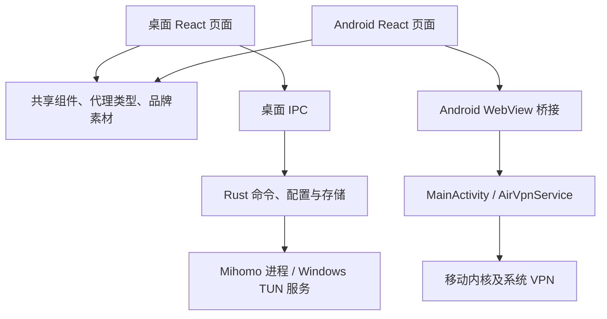

# Air 目录与跨平台架构

Windows 和 Android 共用导航、动效、部分业务组件、品牌图标及地理规则数据。每一端的原生程序负责取得系统授权、运行内核并报告实际连接状态。Windows 使用 Tauri 和独立的 Mihomo 进程，Android 使用 Kotlin、WebView、`VpnService` 和 APK 内的原生库。[桌面入口](../src-tauri/src/main.rs) · [Android 清单](../android/app/src/main/AndroidManifest.xml) · [Android 内核](../android/app/src/main/java/app/air/android/Core.kt)

## 目录与职责

| 目录 | 改动放在哪里 |
| --- | --- |
| [src/app](../src/app)、[src/features](../src/features) | 桌面窗口、标题栏、仪表盘、节点、订阅、连接、设置与更新页面。 |
| [src/platform/desktop](../src/platform/desktop) | `air.ts` 定义桌面 IPC 与返回类型。`browserPreview.ts` 和 `previewConfig.ts` 支持浏览器预览。 |
| [src/shared/proxy](../src/shared/proxy)、[src/shared/ui](../src/shared/ui)、[src/shared/lib](../src/shared/lib) | 代理模式、状态和网络设置类型，导航与启动按钮、应用图标显示、延迟按钮、YAML 编辑器及 UI 工具。组件通过属性和回调接收数据与动作。 |
| [src/assets](../src/assets) | `air-m1.svg` 是界面品牌图，`air.ico` 是系统应用图标。Windows 使用 ICO，Android 打包时从同一文件提取 256 像素 PNG。托盘状态图单独放在 [src-tauri/icons/tray](../src-tauri/icons/tray)。 |
| [src-tauri/src](../src-tauri/src) | `commands` 连接 UI 与 Rust。`subscriptions`、`chains`、`routing`、`network`、`monitoring` 处理订阅、链路、分流、网络设置和测速。`mihomo`、`proxy` 管理内核及接管，`storage` 管本地数据，`updater` 管桌面更新。 |
| [src-tauri/migrations](../src-tauri/migrations)、[src-tauri/tests](../src-tauri/tests)、[src-tauri/windows](../src-tauri/windows) | SQLite 迁移、Rust 集成测试、Windows 安装钩子与内核来源记录。安装资源由 [Windows 配置](../src-tauri/tauri.windows.conf.json) 和 [发布配置](../src-tauri/tauri.windows-release.conf.json) 映射。 |
| [android/web/src](../android/web/src) | 手机页面、订阅模型与配置生成。`bridge.ts` 通过 WebView 消息端口调用 Kotlin。 |
| [android/app](../android/app) | Gradle 构建、APK 资源与权限清单。`MainActivity` 分发桥接请求，`AirVpnService` 管隧道，`Core` 管内核，`AirMonitorService` 管后台探测。 |
| [scripts](../scripts)、[design](../design)、[docs](.) | 构建与清理脚本、可编辑原型与设计稿、开发和发布文档。 |

### 功能调用链

调整启动动效，两端都从 `src/shared/ui` 取组件。调整失败恢复，Windows 从 `proxy`、Android 从 `AirVpnService` 进入。连接列表的应用名和图标由平台解析，共享组件接收显示结果。Android 的 TypeScript 和 Vite 别名只开放 `@/shared` 与 `@/assets`。[共用启动按钮](../src/shared/ui/ProxyPowerButton.tsx) · [应用图标组件](../src/shared/ui/ConnectionApp.tsx) · [手机构建入口](../android/web/vite.config.ts)

### 网络、状态与数据

| 行为 | Windows | Android |
| --- | --- | --- |
| 接管与退出 | 系统代理和 TUN 独立控制。TUN 服务可从应用内安装，安装或维修由 Windows 请求授权，日常开关由服务处理。 | 系统 VPN 授权后由前台服务持有隧道，停止与撤销授权由服务收尾。 |
| 本地数据 | 本地应用数据目录下的 SQLite 保存订阅与测速等记录。订阅原文与 URL 经 Windows DPAPI 用户级保护。全局配置通过带版本校验的文件读写。 | `AirLibrary` 在 `noBackupFilesDir` 保存 `library.json` 和监测结果。运行内核和后台诊断使用独立工作目录，后台服务位于 `:monitor` 进程。 |
| 删除订阅 | 确认后解除该来源的分流引用，将失效出口设为 `REJECT`。存储删除失败时尝试恢复原分流配置。 | 同步处理失效引用，规则或全局模式下删除最后一个可用出站会停止 VPN。 |
| 地理规则冷启动 | 两份锁定版本的规则库在构建时嵌入程序，按运行配置写入内核工作目录。 | Gradle 将相同规则库打入 APK，内核初始化时从 assets 补齐本地缺失的库。 |

实现依据见 [Windows 代理](../src-tauri/src/proxy/mod.rs)、[存储与 DPAPI](../src-tauri/src/storage/mod.rs)、[删除订阅](../src-tauri/src/commands/mod.rs)、[Android 页面动作](../android/web/src/app.tsx)、[Android 数据与监测服务](../android/app/src/main/java/app/air/android/AirMonitorService.kt) 和 [规则库版本](../scripts/mihomo-data.json)。

运行状态由原生层报告，出口 IP 来自经当前代理发出的探测。节点延迟以测试目标和时间为样本，带宽要用传输量与耗时单独测量。桌面轻量探测当前默认并发上限为 8，内核探测超时为 8 秒，默认后台周期为 300 秒。Android 后台任务由系统调度。[桌面调度器](../src-tauri/src/monitoring/mod.rs) · [监测与排序口径](project-standards.md#监测入组和排序口径)

## 后续平台

以下是新平台开始开发时的工程位置与首轮验收方案。平台目录随第一个可运行目标建立。桌面沿用当前 Tauri 工程，手机原生入口按系统独立维护。

| 平台 | 拟用目录与接入方式 | 第一批交付条件 |
| --- | --- | --- |
| iOS（iPhone） | `ios/` 管 Xcode 主应用与 Packet Tunnel Provider 扩展。主应用交付配置，扩展持有隧道。先验证能嵌入扩展的内核及资源占用。 | 在签名真机上完成授权、域名与 IP 分流、锁屏、Wi-Fi/蜂窝切换和断开恢复。按应用 VPN 单独在受管设备验证。[Apple 部署条件](https://developer.apple.com/documentation/technotes/tn3134-network-extension-provider-deployment) |
| macOS | `src/app` 与 `src-tauri` 继续承载桌面程序，`src-tauri/macos/` 放签名、权限及必要的原生扩展。适配系统代理、凭据存储与撤销接管。 | 确定商店或 Developer ID 分发渠道后，验证该渠道允许的扩展形式、签名安装、启停与 DNS 和路由恢复。[Apple Network Extension](https://developer.apple.com/documentation/technotes/tn3134-network-extension-provider-deployment) |
| HarmonyOS（鸿蒙手机） | `harmony/` 管 Stage 工程、ArkTS 页面或桥接及 `VpnExtensionAbility`。验证原生内核与系统隧道接口。 | 在目标系统真机完成 VPN 授权、内核收发、网络切换、退出恢复及签名 HAP 覆盖安装。[华为 VPN 扩展开发指南](https://developer.huawei.com/consumer/cn/doc/harmonyOS-guides/net-vpnextension/) |
| Linux | 沿用 `src/app` 与 `src-tauri`，`src-tauri/linux/` 放打包及权限配置。Rust 端适配桌面环境的代理设置、凭据存储、DNS 和 TUN。 | 选定首个发行版，验证普通用户安装与启动、`/dev/net/tun` 授权、关闭后恢复系统设置及卸载。[Linux TUN/TAP](https://docs.kernel.org/networking/tuntap.html) · [Tauri 构建环境](https://v2.tauri.app/start/prerequisites/) |

新平台先走通一条完整路径。用本地测试订阅导入一个节点，取得系统授权后启动，核对出口，再停用并检查 DNS 与路由恢复。随后对齐订阅更新与删除、应用识别、后台测速、数据升级和签名覆盖安装。优先复用现有 UI、图标和规则数据。跨语言运行时需要实现同一条业务规则时，用同一组脱敏输入和预期结果核对两端行为，再决定是否抽取公共实现。

构建命令、缓存与可删除目录见 [开发与清理](development.md)。交互目标和验收口径见 [项目规范](project-standards.md)。
