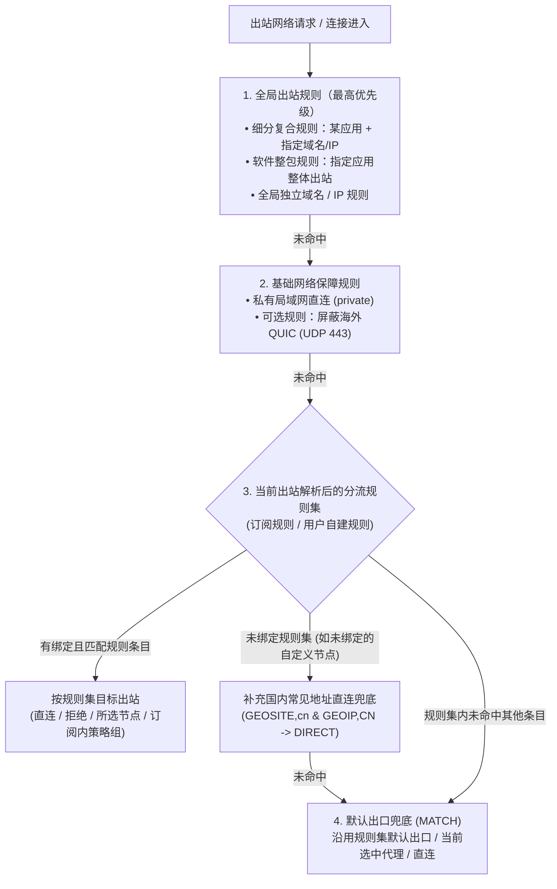

# 分流规则管理与灵活绑定需求文档

- **适用范围**：Air Windows 桌面版、Air Android 手机版
- **涉及模块**：设置（分流规则）、节点库（订阅节点 / 自定义节点 / 自定义分组 / 链路）、订阅、实时连接与连接日志

---

## 1. 核心设计理念

1. **不造新标准，灵活复用现有标准**

   - 完全兼容 Mihomo / Clash 通用规则语法（`DOMAIN`、`DOMAIN-SUFFIX`、`IP-CIDR`、`PROCESS-NAME`、`AND/OR/NOT` 复合规则、`RULE-SET` 等）以及订阅自带的 `proxy-groups` 策略语义（保留 `select`、`url-test`、`fallback`、`load-balance` 的标准行为）。
   - 不强行篡改或发明脱离行业标准的规则语义，避免产生兼容性异常或排查成本。

2. **用哪个出站，就按对应规则 + 全局规则执行，且允许自由换绑**

   Air 提供了统一的节点库（可混合展示、测速、切换多个订阅的节点，以及将节点加入自定义分组、创建自定义节点），因此规则系统必须围绕“灵活使用节点”来设计：

   - **不绑定时零配置开箱可用**：订阅节点默认沿用自身所属订阅的规则；自定义节点默认仅走全局规则 + 私有/国内直连兜底；自定义分组默认不强制改写组内节点各自原有的规则归属。
   - **需要时任意跨订阅/跨规则绑定**：无论是**整个订阅**、**某个自定义分组**、**某个订阅节点**还是**某个自定义节点**，都可以显式绑定**另一份订阅自带规则**或**用户自建规则**。

3. **全局出站规则永远最高优先级**

   用户在全局添加的软件（应用）规则、域名/IP 规则与在「实时连接」中修改的应用/目标分流策略，优先级始终高于任何订阅自带规则或用户绑定规则集。

4. **实际出口全透明可追踪**

   当订阅内部包含多个自动测速组或复杂跳转时，不靠猜测，直接通过「实时连接」与「连接日志」查看每条连接命中的规则路径与实际出口节点名，形成可观测闭环。

---

## 2. 背景与现有痛点

结合当前双端实现与使用场景，亟待梳理并解决以下问题：

1. **规则绑定能力受限**

   当前仅“自动跟随当前选中节点所属订阅”，尚不支持把“订阅自带规则”和“用户自建规则库”放在一起管理，也无法实现“给自定义分组指定专属规则”“让 A 订阅的某个节点/整个 A 订阅借用 B 订阅规则”“给自定义节点绑定指定规则”。

2. **桌面端与手机端分流设置页不对齐**

   桌面端「设置 → 分流规则」仍保留旧版遗留的手动「订阅规则来源」下拉框和「在自定义规则之后匹配该订阅的规则」复选框（实际在选定节点/链路启动时已被后端忽略），且订阅被移除时可能将默认出口变为「拒绝连接」，极易造成误解。

3. **设置页里的全局出站规则展示过于平铺冗长**

   - 用户在「实时连接」或「连接日志」为某个软件配置过出站策略（尤其是同时包含软件整包策略和一条/多条细分域名例外规则时），回到「设置 → 分流规则」需要清晰看到“改了哪些软件的规则”。
   - 现状将所有规则展开为完整表单卡片，规则一多会非常长且难以快速浏览某个软件的所有策略。

---

## 3. 核心业务模型

### 3.1 统一「分流规则库」

将软件内所有中层分流方案统一管理于**分流规则库**中，作为可被复用的独立实体：

| 规则集类型 | 来源与维护方式 | 内容标准 | 说明 |
| --- | --- | --- | --- |
| **订阅自带规则** | 导入或同步订阅时自动提取生成（含 `rules` 与 `rule-providers`） | 原生 Clash / Mihomo 规则及规则集 | 与原订阅绑定同步更新，也可经订阅扩展脚本或附加规则调整 |
| **用户自建规则集** | 用户在「分流规则库」中新建、编辑、复制、导入或导出 | 标准 Clash / Mihomo 规则列表（可含策略组或通用直连/拒绝/代理目标） | 与订阅规则平级陈列，供任意订阅、分组或节点按需选用 |

> **目标映射通用原则**：用户自建规则集内涉及“走代理”的标准占位/选择组目标时，自动映射到当前用户选定的代理出站（`GLOBAL` / 当前节点或链路），保留 `DIRECT` 与 `REJECT` 语义不变；订阅自带规则保留方案 B（`select` 跟随当前选择，固定节点或 `url-test` 等自动组按订阅自身定义执行）。

### 3.2 四类可绑定对象与绑定策略

每类对象均拥有独立的「分流规则」配置字段，支持三种状态：**跟随默认（未指定）** / **指定某套分流规则（任意订阅自带规则或用户自建规则）** / **不使用附加规则（仅走全局规则 + 兜底）**。

| 出站/管理对象 | 默认行为（未单独指定规则时） | 支持的显式绑定操作 | 典型使用场景 |
| --- | --- | --- | --- |
| **整份订阅** | 使用本订阅自身携带的分流规则 | 绑定其它订阅自带规则 / 绑定用户自建规则 / 不使用订阅规则 | A 机场节点速度快但无分流规则，将整份 A 订阅一键绑定到 B 订阅的规则或自建规则 |
| **自定义分组** | 不强制覆盖（按组内所选节点自身原本的规则执行；若以分组本身作为自动策略出站且成员跨多个订阅，仅走全局规则与默认兜底） | 为该分组指定一套分流规则（任意订阅规则或自建规则） / 明确清空走默认 | 创建「AI 工作组」「流媒体组」时，为整组绑定一套专门针对性的自建规则或订阅规则 |
| **订阅节点（单节点）** | 跟随其所属订阅当前生效的分流规则（即：若所属订阅改绑了规则则跟随之，否则走原订阅规则） | 为单个节点绑定指定分流规则 / 不使用订阅规则 | 95% 节点保持默认跟随所属订阅；极少数常用节点按需绑定独立规则 |
| **自定义节点（含多跳链路）** | 无所属订阅规则，默认走「全局规则 + 私有地址/国内直连兜底 + 默认出口」 | 为自定义节点或链路选择绑定某套订阅规则或自建规则，也可保持不绑定 | 自己搭建的 VPS 节点可以直接绑定一份成熟的国内/海外分流规则集，无需手动一条条重配 |

### 3.3 多层级规则解析与优先级

#### A. 当前激活分流规则集的解析顺序

当用户在「节点库」或「仪表盘」选中某一个出站并使用规则模式时，生效的分流规则集按以下就近原则解析（命中即止）：

1. **正在使用的出站本身显式绑定了规则**（如单节点单独绑定 / 自定义节点绑定 / 多跳链路绑定 / 正在以「自定义分组」作为当前出站且该分组绑定了规则）→ 采用该绑定规则集；
2. **仅在用户通过某个「自定义分组」上下文选中组内单节点、或分组自带统一规则上下文下** → 若分组显式绑定了规则，采用分组绑定规则；
3. **所属订阅显式绑定或自带的规则** → 对未绑定规则的订阅节点，采用其所属订阅当前生效的规则（若所属订阅换绑了其它规则则取换绑后的，否则取原订阅自带规则）；
4. **均未绑定**（例如未绑定任何规则的自定义节点、不带规则集的纯节点）→ 进入无订阅规则集模式，由全局规则与内置私有/国内直连兜底接管。

> **关于单节点同时属于多个自定义分组的规则约定**：如果节点 X 同时被加入了「分组 A」和「分组 B」，用户在「全部节点」下直接选中单节点 X 出站且节点 X 未单独绑定规则时，节点 X 沿用自身原订阅规则，不会因它被收藏进某个分组而发生歧义；只有当用户直接选择「分组 A」出站或给节点 X 本身单独绑规则时，才套用对应规则。

#### B. 运行时流量匹配执行顺序（从高到低）

---

## 4. 页面与交互需求详述

### 4.1 设置 → 分流规则页面重构

#### 1) 顶层规则概览区（双端统一，清理桌面端旧困惑项）
- **移除**桌面端当前在选节点模式下失效的手动「订阅规则来源」下拉框与「在自定义规则之后匹配该订阅的规则」复选框；同时取消旧版移除订阅时自动将默认出口改成「拒绝连接」的逻辑（默认回落至「沿用默认规则出口 / 当前选中代理」）。
- 改为清晰展示：
  - **当前生效出站与规则来源（只读状态卡片）**：直观告诉用户“当前选中的是哪个节点/分组/链路 → 实际正在使用哪套分流规则（来自原订阅默认 / 手动绑定的某规则集 / 无附加规则）”，并支持一键跳转至「分流规则库」调整绑定。
  - **全局默认出口（MATCH 兜底）**：全局统一的未命中兜底策略（默认沿用所生效规则集的默认出口；无规则集时默认走当前所选代理，用户亦可设为直连）。

#### 2) 全局出站规则：紧凑列表项（一行一项）+ 点击弹框看详情
所有用户自定义全局规则从原本“铺开的长表单”改造成**轻量紧凑列表**，支持拖拽/上下调整优先级，按以下两种形态聚合展示：

1. **软件（应用）出站规则（按软件自动聚合为一项）**
   - 凡是在「实时连接」「连接日志」或设置页中为同一应用（Windows 进程名/路径，Android 应用包名）设置过的整包规则或「应用 + 域名/IP」精细复合规则，在全局规则列表里**合并展示为一项**：
     - **左侧图标与名称**：显示应用图标 + 应用显示名（如 `微信`、`Chrome`，识别不到图标时显示默认应用图标 + 进程名/包名）。
     - **核心摘要副标题**：进程名 / 包名（如 `wechat.exe` / `com.tencent.mm`）及附加细分规则计数（如“含 2 条域名例外”）。
     - **右侧操作区**：
       - **默认出站 Tag 徽章**：显示该软件的整体主出口方向（如 `直连`、`代理`、`拒绝` 或具体节点名；若仅配置了部分域名例外，标示为 `按域名细分`）。
       - **整组启用 Switch 开关**：直接控制该软件下规则的启用/停用（不误触详情弹窗）。
       - **展开/详情提示图标**：右侧轻量箭头（`>`）。
   - **点击整行打开「软件分流详细弹框」**：
     - 桌面端弹出 **Dialog**，手机端弹出底部 **Sheet**（风格与「实时连接 → 修改分流策略」弹框保持高度一致）。
     - 弹框内完整查看和编辑：
       - 该软件的**默认整体出站**（保持订阅规则、整个软件直连、整个软件走代理、指定固定节点/链路/分组、拒绝）；
       - 该软件下挂的**全部精细域名 / IP 例外规则列表**（每条支持新增、编辑、修改出站、开启/停用、删除）；
       - 修改保存后立即刷新并实时应用到运行中的 Mihomo 内核。
2. **全局独立域名 / IP 规则（每条一行）**
   - **行内展示信息**：规则序号、匹配类型徽章（如 `域名后缀`、`完整域名`、`IP / 网段`）、匹配值（单行截断显示，完整内容在悬浮提示或弹框中可见）、出站目标 Tag 徽章、启用 Switch 开关。
   - **点击整行打开「规则详情编辑弹框」**：查看和修改匹配方式、匹配值、目标出站，或执行调整顺序、删除操作。

> **桌面端与手机端编辑入口统一**：用户既可以在「实时连接 / 连接日志」点开一条具体连接快速修改该软件或域名的出站，也可以随时到「设置 → 分流规则」的对应行中集中查看、调整与清理。

---

### 4.2 统一「分流规则库」管理与绑定入口

1. **分流规则库管理页面（或弹窗抽屉）**

   列表统一展示两大分组：

   - **订阅自带规则**：显示订阅名称、规则条数、最后更新时间、被哪些节点/分组绑定引用；
   - **用户自建规则**：支持新建空白规则集、从现有订阅规则复制一份作为模板编辑、直接编辑标准 Clash `rules` / 可视化规则条目、删除（删除时友好提示并解绑关联对象，回落为默认）。
2. **各处绑定选择器（「分流规则」字段）**
   - 在以下四个位置的编辑/配置入口中增加一致的「分流规则」下拉选择：
     - **订阅管理菜单 → 编辑订阅 / 分流规则**（控制整份订阅默认走哪套规则）；
     - **自定义分组编辑器**（新建或编辑自定义分组时指定该分组专属规则，默认为「跟随默认/不指定」）；
     - **节点详情 / 覆写编辑器**（为单个订阅节点覆盖绑定规则，默认为「跟随所属订阅」）；
     - **自定义节点 / 链路编辑器**（为自定义节点或链路选择绑定的规则集，默认为「不使用（仅全局 + 默认兜底）」）。
   - 下拉选项结构清晰分组：`跟随默认` / `不使用规则集（仅全局与直连兜底）` / `订阅规则` 分组 / `用户自建规则` 分组。

---

## 5. 可观测性与诊断能力保障

1. **预览生效规则（双端）**：设置页的「预览生效规则」按钮需按真实运行时逻辑展示**当前所选出站**最终生成的有序规则清单，并在顶部注明每段规则来源（全局规则 → 基础保障 → 解析后使用的规则集名称 → 默认兜底）。
2. **实时连接与连接日志闭环**：
   - 在首页「实时连接」和「连接日志」的代理出口 `Tag` 直接显示实际出站节点名称（不加冗余前缀），连接详情中保留完整命中规则（`rule` + `rulePayload`）与链路跳点路径（`chains`）。
   - 用户发现某条连接实际走错了节点，可直接点开该连接一键修正软件/域名策略，随后即可在「设置 → 分流规则」对应的软件或域名聚合项中看到并再次编辑。

---

## 6. 建议分阶段实施顺序

| 阶段 | 目标与范围 | 验收关键点 |
| --- | --- | --- |
| **第一阶段：数据模型与编译链路整理** | 1. 清理桌面端无用的手动「订阅规则来源」入口与失效变「拒绝连接」的旧逻辑，桌面端 `fallback` 生效与手机端完全对齐； 2. 在存储结构中扩展「用户自建规则集」及订阅/分组/节点的可选规则集 ID 字段； 3. 双端规则编译器实现统一解析顺序。 | 不做额外配置时，现有用户迁移 100% 保持原行为；桌面与手机「预览生效规则」顺序一致。 |
| **第二阶段：设置页全局规则聚合展示 + 弹框详情** | 1. 将双端「设置 → 分流规则」中的软件（应用）规则按软件聚合为紧凑列表项，独立域名/IP 规则收拢为紧凑单行； 2. 实现点击列表项弹出软件分流详情弹框 / 规则详情弹框编辑； 3. 支持从「实时连接」加完策略后，在设置页精准查看与维护。 | 添加十余条软件和域名规则后，设置页仍清爽一屏可览，点击任意软件项可完整查看修改全部细则。 |
| **第三阶段：统一分流规则库与四类对象绑定界面** | 1. 新增「分流规则库」管理界面（用户自建规则集 + 订阅规则列表与克隆模板）； 2. 为订阅、自定义分组、订阅节点、自定义节点/链路补充统一的「分流规则」绑定选择器。 | 可完成：A 订阅节点绑 B 订阅规则、自定义节点绑指定规则、自定义分组配专属规则并正常生效。 |
